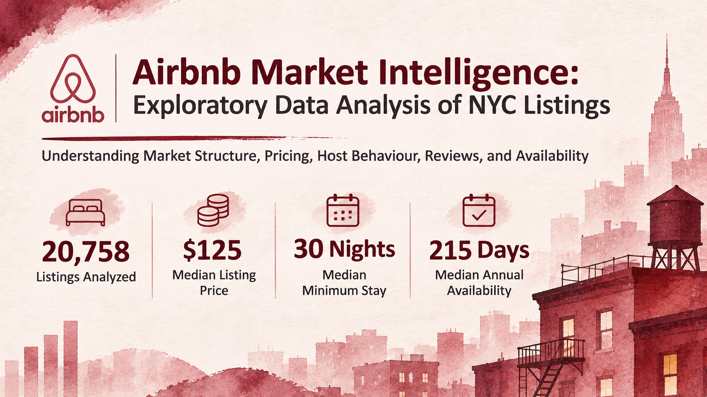
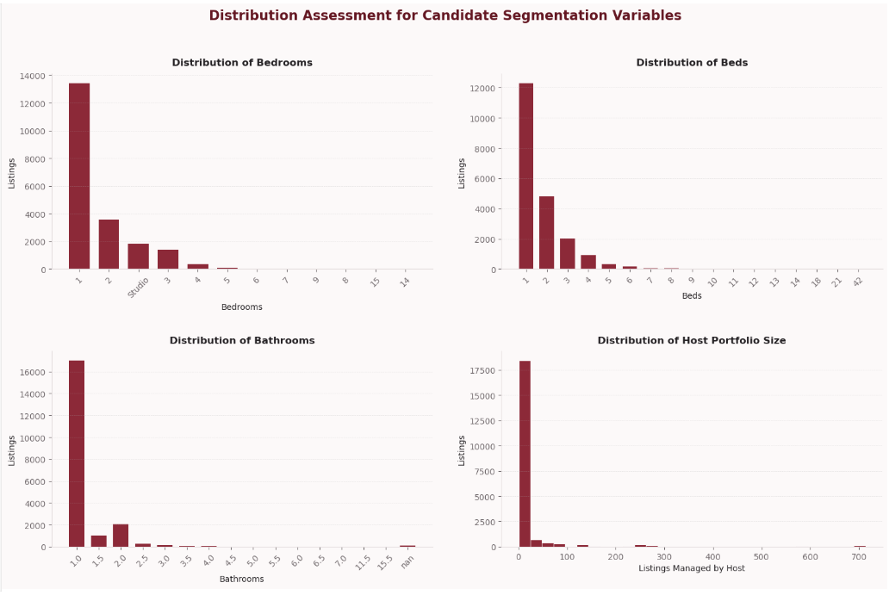
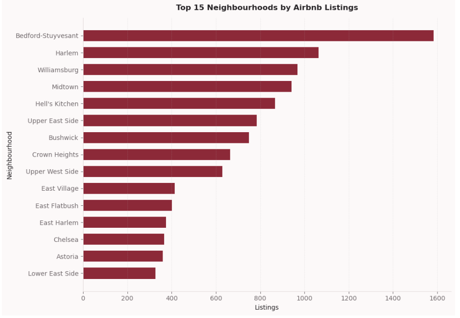
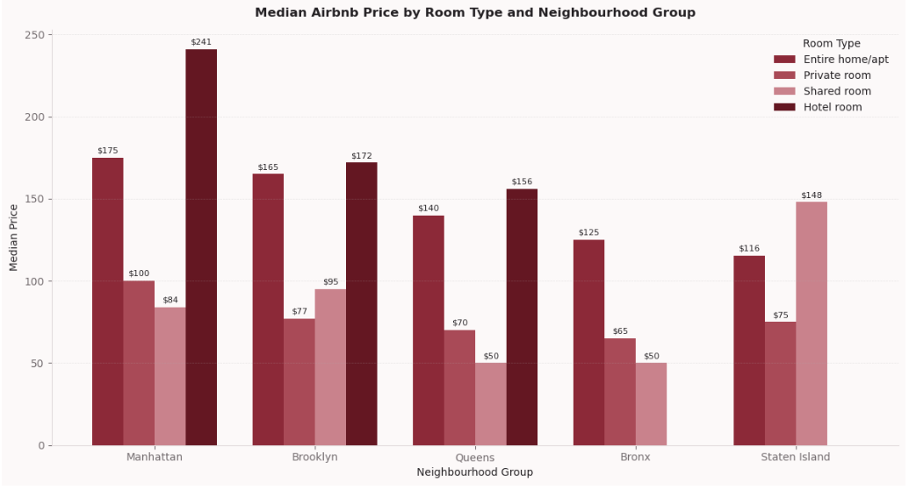
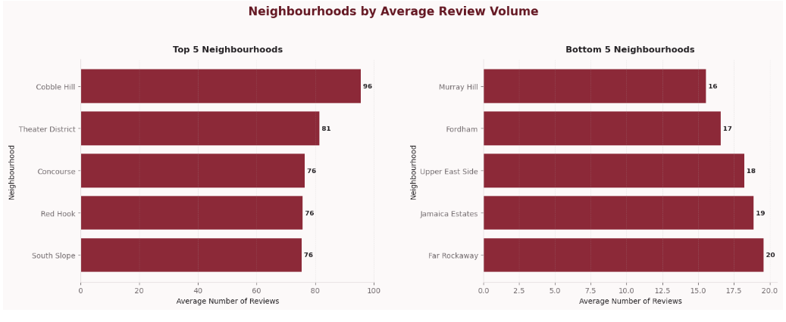
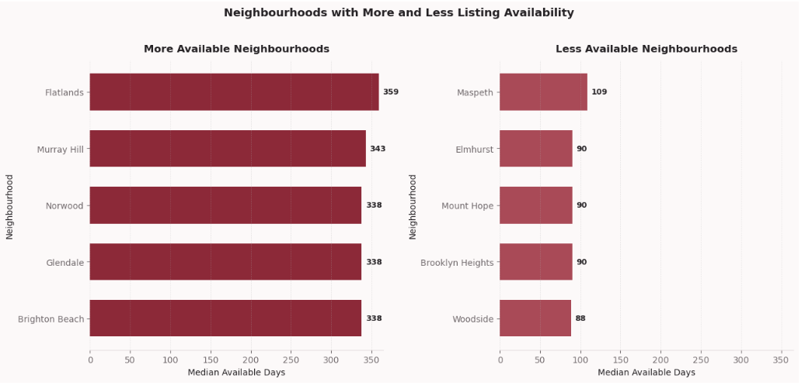

# ■ Airbnb Market Intelligence: Exploratory Data Analysis of NYC Listings

<figure>

<figcaption aria-hidden="true">Airbnb Market Intelligence — Exploratory
Data Analysis of NYC Listings</figcaption>
</figure>

## ▪ From Raw Listings to Market Intelligence

Airbnb’s NYC marketplace is not one uniform market.

Pricing, listing supply, review activity, availability, room type,
property characteristics, and host portfolio structure vary
substantially across local markets. This project uses **Python and
Pandas to move from raw listing data to evidence-based business
insights**—with the analytical decisions documented along the way.

The objective was not simply to create charts. It was to understand the
structure of the data, assess its quality, create meaningful analytical
features, investigate market patterns, and translate those patterns into
practical business implications.

------------------------------------------------------------------------

## ▪ Why This Project Matters

Airbnb is a useful example of a **multi-dimensional marketplace where broad averages can hide important local differences**. A listing's price, availability, review activity, room type, property characteristics, and host portfolio structure can all vary substantially across neighbourhoods.

This project was selected to examine how an analyst can take a relatively raw marketplace dataset and turn it into **structured, decision-ready business intelligence**.

The importance of the project is therefore not only the Airbnb market itself. It is the analytical process behind it:

- understanding a real-world business context
- assessing the quality and structure of raw data
- using Python and Pandas to prepare and transform the data
- choosing analytical measures and segments based on the observed distributions
- investigating patterns across multiple business dimensions
- translating evidence into practical recommendations
- clearly separating what the data supports from what it cannot establish

The project demonstrates the complete journey from **raw data → analytical evidence → business interpretation → action**.

------------------------------------------------------------------------

## ▪ Business Questions

The analysis was designed around eight practical questions:

1.  How is Airbnb listing supply distributed geographically and across
    accommodation types?
2.  How does listing price vary across neighbourhoods, room types, and
    property characteristics?
3.  How do room type and geography interact to influence pricing?
4.  How does host portfolio size relate to listing supply, pricing, and
    review activity?
5.  What patterns can be observed in review activity across listing and
    neighbourhood characteristics?
6.  How does listing availability vary across room types and
    neighbourhoods?
7.  How do minimum-stay requirements relate to listing pricing and
    market positioning?
8.  What actionable insights can be derived—and what conclusions should
    not be drawn from the available data?

------------------------------------------------------------------------

## ▪ Project at a Glance

| Metric                     |        Result |
|----------------------------|--------------:|
| Raw records                |        20,770 |
| Variables                  |            22 |
| Exact duplicates removed   |            12 |
| Final analytical records   |        20,758 |
| Median listing price       |     **\$125** |
| Median minimum stay        | **30 nights** |
| Median annual availability |  **215 days** |

### ▫ Analytical Areas

**Market Structure · Pricing · Guest Engagement · Availability · Host
Analytics · Neighbourhood Analysis · Minimum-Stay Behaviour**

------------------------------------------------------------------------

## ▪ Analytical Workflow

``` text
Business Context
      ↓
Data Loading
      ↓
Initial Data Understanding
      ↓
Data Quality Assessment
      ↓
Data Cleaning & Type Standardisation
      ↓
Feature Engineering
      ↓
Exploratory Data Analysis
      ↓
Pattern & Segment Comparison
      ↓
Business Interpretation
      ↓
Recommendations & Limitations
```

The workflow deliberately separates **data preparation**, **analytical
transformation**, and **business interpretation** so that each
conclusion can be traced back to the underlying data.

------------------------------------------------------------------------

# ■ Data & Data Handling

## ▪ Dataset

The project uses a raw Airbnb NYC listings dataset containing **20,770
records across 22 variables** before data-quality treatment.

The dataset includes information covering:

- listing and host identifiers
- neighbourhood and neighbourhood group
- geographic coordinates
- room type
- price
- minimum nights
- review activity
- review recency and review frequency
- host portfolio size
- annual availability
- bedrooms, beds, and bathrooms
- ratings and licensing information

The raw dataset is preserved separately from the analytical outputs.

### ▫ Repository data flow

``` text
data/raw/
    └── Airbnb Datasets.csv
              ↓
      Python / Pandas
              ↓
     cleaned analytical DataFrame
              ↓
      feature engineering
              ↓
       EDA & visualisation
              ↓
       business insights
```

------------------------------------------------------------------------

## ▪ Data Quality & Preparation

The data-quality stage was designed to determine **which observations
required treatment**, rather than applying blanket cleaning rules.

### ▫ Missing values

The dataset was largely complete:

- 20,736 records had no missing fields
- 27 records had one missing field
- 7 records had 12 missing fields

Missing values were **retained rather than blindly imputed or removed**.
Variables were handled contextually when required for a specific
analysis.

### ▫ Duplicate records

The dataset contained **12 exact duplicate rows**.

These records were inspected before treatment and confirmed to be
duplicated across the available fields. The duplicate copies were
removed because they could distort counts and aggregate calculations.

### ▫ Data-type standardisation

Variables were converted according to their analytical meaning,
including:

- identifiers → string
- dates → datetime
- price and continuous measures → numeric
- count variables → nullable integer types
- ratings and bathroom measures → numeric where appropriate

This produced a more reliable analytical structure without unnecessarily
altering the underlying observations.

### ▫ Contextual data-quality treatment

Several fields required interpretation rather than simple type
conversion.

Examples include:

- `"Studio"` values in the bedrooms field
- unavailable bathroom values
- zero bathroom observations
- skewed count variables
- highly concentrated minimum-stay values

The principle throughout was:

> **Treat unusual values as data-quality questions first, not as errors
> by default.**

------------------------------------------------------------------------

# ■ Feature Engineering

Feature engineering was used only where broader categories provided a
meaningful analytical advantage over the original variables.

The original fields were retained while derived analytical features were
added.

## ▪ Bedroom Segmentation

The bedrooms distribution is strongly concentrated around smaller
properties, so the original bedroom field was transformed into:

- Studio
- 1 Bedroom
- 2 Bedrooms
- 3 Bedrooms
- 4+ Bedrooms

## ▪ Bathroom Segmentation

Bathroom counts were grouped into:

- 1 Bath
- 1.5–2 Baths
- 2.5+ Baths

This preserved the dominant one-bathroom structure while avoiding overly
sparse categories.

## ▪ Host Portfolio Segmentation

Host portfolio size was grouped into:

- Single Listing — 1
- Small Portfolio — 2–5
- Medium Portfolio — 6–15
- Large Portfolio — 16–30
- Very Large Portfolio — 31+

This makes it possible to compare individual hosts with progressively
larger operators.

## ▪ Review Volume Segmentation

Review counts were grouped into:

- Limited Review Base — 1–5
- Developing Review Base — 6–20
- Established Review Base — 21–50
- Strong Review Base — 51–100
- Extensive Review Base — 101+

## ▪ Minimum-Stay Segmentation

The observed distribution was highly concentrated at a **30-night
minimum stay**, so the original variable was transformed into:

- Short Stay — 1–7 nights
- Extended Short Stay — 8–29 nights
- Monthly Stay — 30 nights
- Long Stay — 31–90 nights
- Very Long Stay — 91+ nights

### ▫ Why this matters

These segments were not introduced simply to make charts easier to read.
Their thresholds were informed by the underlying distributions and the
analytical questions being investigated.

------------------------------------------------------------------------

## ▪ Distribution Assessment

Before creating the segmentation variables, the distributions of
candidate variables were inspected to understand their concentration and
long-tail behaviour.

<figure>

<figcaption aria-hidden="true">Distribution Assessment for Candidate
Segmentation Variables</figcaption>
</figure>

**What this demonstrates:** the feature-engineering stage was
distribution-led rather than based on arbitrary categorical thresholds.

------------------------------------------------------------------------

# ■ Exploratory Data Analysis

## ▪ 1. Market Structure — Where Is Supply Concentrated?

The first analytical step establishes the geographic and accommodation
structure of the market.

<figure>

<figcaption aria-hidden="true">Top 15 Neighbourhoods by Airbnb
Listings</figcaption>
</figure>

### ▫ What the analysis shows

Listing supply is highly concentrated across specific neighbourhoods,
with **Bedford-Stuyvesant** leading the top 15 neighbourhoods by listing
volume.

At the broader neighbourhood-group level, **Manhattan and Brooklyn
dominate the listing base**, creating an important geographic context
for the pricing and performance analyses that follow.

**Business implication:** city-wide averages can conceal substantial
differences in local market scale.

------------------------------------------------------------------------

## ▪ 2. Pricing — How Does Location Interact With Room Type?

Pricing was examined across neighbourhood groups, room types, bedroom
segments, bathroom segments, host portfolio segments, and minimum-stay
segments.

The strongest interaction was between **room type and geography**.

<figure>

<figcaption aria-hidden="true">Median Airbnb Price by Room Type and
Neighbourhood Group</figcaption>
</figure>

### ▫ What the analysis shows

Room type creates distinct pricing tiers, but those tiers do not behave
identically across neighbourhood groups.

For example, the median price of an **Entire home/apt** differs
substantially across the five neighbourhood groups, while the relative
positioning of other room types also changes by geography.

The analysis therefore treats **room type and location as interacting
pricing dimensions**, rather than interpreting either variable in
isolation.

### ▫ Additional pricing patterns

- Manhattan carries a clear price premium.
- Larger bedroom configurations generally command higher prices.
- Larger bathroom configurations generally command higher prices.
- Neighbourhood-level differences are wider than broad
  neighbourhood-group averages suggest.

**Business implication:** competitive pricing should be benchmarked
against the local neighbourhood and property format—not simply against a
city-wide or neighbourhood-group average.

------------------------------------------------------------------------

## ▪ 3. Listing Performance & Guest Engagement

Review activity was used as an observable indicator of listing-level
engagement.

The analysis compares average review volume across:

- room types
- neighbourhood groups
- host portfolio segments
- neighbourhoods

<figure>

<figcaption aria-hidden="true">Neighbourhoods by Average Review
Volume</figcaption>
</figure>

### ▫ What the analysis shows

Review activity varies meaningfully across local markets.

Among sufficiently represented neighbourhoods, **Cobble Hill** has the
highest average review volume in the selected comparison, while **Murray
Hill** sits at the lower end.

The host analysis also shows a pattern of stronger average review
activity among smaller host portfolios, with average review volume
declining across progressively larger portfolio segments.

**Important interpretation:** review volume is treated as **review
activity**, not as a direct measure of demand or occupancy.

------------------------------------------------------------------------

## ▪ 4. Neighbourhood Pricing Deep Dive

Broad neighbourhood groups provide useful context, but they can hide
substantial local variation.

The analysis therefore compares neighbourhood-level median prices using
a minimum listing-representation threshold so that very small
neighbourhood samples do not dominate the comparison.

### ▫ What the analysis shows

Higher-priced neighbourhoods include **Tribeca, SoHo, and Greenwich
Village**, while lower-priced neighbourhoods in the represented
comparison include **Woodside, Jamaica Estates, and Mount Hope**.

**Business implication:** neighbourhood-level context is essential when
evaluating pricing opportunities.

------------------------------------------------------------------------

## ▪ 5. Availability Analysis

Availability was examined to understand how frequently listings remain
available throughout the year.

<figure>

<figcaption aria-hidden="true">Neighbourhoods with More and Less Listing
Availability</figcaption>
</figure>

### ▫ What the analysis shows

Listing availability varies substantially across neighbourhoods.

The more-available comparison is led by **Flatlands**, while
**Woodside** appears at the lower end of the less-available comparison.

Availability also differs across room types, indicating that inventory
behaviour is not uniform across accommodation formats.

**Business implication:** local availability should be evaluated
alongside pricing and review activity when assessing market conditions.

------------------------------------------------------------------------

## ▪ 6. Host Market Structure

Host portfolio size was analysed to understand whether listing supply is
concentrated among large operators or distributed across smaller hosts.

The market shows a strong presence of:

- Single Listing hosts
- Small Portfolio hosts

Medium, Large, and Very Large Portfolio hosts collectively represent a
smaller portion of listing supply.

**Business implication:** the market is relatively distributed across
individual and small-scale operators rather than being dominated by
large portfolio hosts.

------------------------------------------------------------------------

# ■ Key Findings

### ▫ 01 — Supply is geographically concentrated

Manhattan and Brooklyn account for the largest share of listing supply,
while neighbourhood-level supply is also uneven.

### ▫ 02 — Location and property characteristics are strong pricing differentiators

Neighbourhood, bedroom capacity, and bathroom capacity show substantial
relationships with listing price.

### ▫ 03 — Room type creates distinct pricing tiers

Entire home/apt listings generally sit above Private and Shared rooms,
but the size of the gap varies across neighbourhood groups.

### ▫ 04 — Review activity varies across listing and host characteristics

Review activity differs across room types, neighbourhoods, and host
portfolio sizes, with smaller portfolios showing stronger average
activity.

### ▫ 05 — Availability varies substantially across local markets

Some neighbourhoods have listings available for much of the year, while
others show considerably lower availability.

### ▫ 06 — The market has a broad base of individual and small-scale hosts

Single Listing and Small Portfolio hosts represent the largest share of
listing supply.

### ▫ Overall Finding

The strongest pattern across the analysis is that **Airbnb market
performance varies considerably by location and listing
characteristics**.

Broad averages can therefore hide meaningful differences between
neighbourhoods, accommodation formats, property sizes, and host
structures.

------------------------------------------------------------------------

# ■ Business Recommendations

## ▪ 1. Adopt neighbourhood-level pricing strategies

Pricing decisions should consider **specific neighbourhood conditions,
room type, and property characteristics** rather than relying solely on
broad city-level or neighbourhood-group benchmarks.

## ▪ 2. Use property characteristics for premium positioning

Listings with greater bedroom and bathroom capacity generally command
higher prices.

Hosts managing larger properties should emphasise **space, capacity, and
accommodation value** when positioning their listings.

## ▪ 3. Combine location and room type when setting prices

Room type and geography jointly influence pricing.

Competitive price ranges should therefore be evaluated within the
context of the local accommodation market.

## ▪ 4. Strengthen listing-level engagement as portfolios grow

Larger host portfolios show lower average review activity per listing.

Hosts managing multiple properties should focus on **consistent listing
quality, guest experience, and review generation across individual
properties**, rather than relying solely on portfolio expansion.

## ▪ 5. Use neighbourhood-level availability to identify market opportunities

Availability patterns differ considerably across neighbourhoods.

Hosts and market operators can evaluate **local availability alongside
pricing and review activity** to identify areas with different supply
conditions.

## ▪ 6. Build support strategies around the small-host majority

Individual and small-portfolio hosts represent the largest share of
listing supply.

Platform-level initiatives should therefore provide accessible
**pricing, listing optimisation, and performance insights** that are
useful to smaller operators.

### ▫ Overall Recommendation

The analysis supports a **localised and listing-specific approach to
Airbnb decision-making**.

------------------------------------------------------------------------

# ■ Analytical Decisions That Shaped the Analysis

| Decision                                  | Analytical Rationale                                                                                                         |
|-------------------------------------------|------------------------------------------------------------------------------------------------------------------------------|
| Retain missing values                     | Missingness was limited and the remaining information could still be useful for analyses not dependent on the missing field. |
| Remove exact duplicates                   | Duplicate rows could distort counts and aggregate measures.                                                                  |
| Use medians for price comparisons         | Listing prices are highly skewed, making the median a more representative measure of typical listing price.                  |
| Inspect distributions before segmentation | Category thresholds were informed by observed concentration and long-tail behaviour.                                         |
| Use representation thresholds             | Neighbourhood comparisons can become misleading when very small groups are included.                                         |
| Treat review volume as review activity    | Review counts do not directly establish occupancy, demand, or revenue.                                                       |
| Compare interactions, not only averages   | Room type and geography jointly reveal pricing differences that broad averages can hide.                                     |
| Preserve original variables               | Derived features support analysis without replacing the underlying data.                                                     |

------------------------------------------------------------------------

# ■ Python & Pandas Analytical Build

This project demonstrates Python as an **analytical workflow**, not
merely as a charting tool.

### ▫ Data manipulation

- Pandas DataFrames for structured analysis
- filtering and conditional transformations
- `groupby()` aggregation
- `value_counts()`
- descriptive statistics
- missing-value assessment
- duplicate detection and treatment
- type conversion
- derived analytical features

### ▫ Numerical analysis

- NumPy for numerical operations
- descriptive statistics
- distribution assessment
- median-based comparisons
- percentage and count calculations

### ▫ Visualisation

- Matplotlib for controlled chart construction
- Seaborn for analytical visualisation
- consistent visual language across the project
- annotated business-facing charts
- distribution and comparison plots

### ▫ Example analytical pattern

``` python
neighbourhood_group_counts = (
    df["neighbourhood_group"]
    .value_counts()
    .sort_values(ascending=False)
)
```

Feature engineering follows the same Pandas-first approach:

``` python
df["bedroom_segment"] = pd.Series(
    pd.NA,
    index=df.index,
    dtype="string"
)

df.loc[df["bedrooms"].eq("Studio"), "bedroom_segment"] = "Studio"
df.loc[bedrooms_numeric.eq(1), "bedroom_segment"] = "1 Bedroom"
df.loc[bedrooms_numeric.eq(2), "bedroom_segment"] = "2 Bedrooms"
df.loc[bedrooms_numeric.eq(3), "bedroom_segment"] = "3 Bedrooms"
df.loc[bedrooms_numeric.ge(4), "bedroom_segment"] = "4+ Bedrooms"
```

The important point is the complete chain:

**inspect → decide → transform → validate → analyse → interpret**

------------------------------------------------------------------------

# ■ What This Project Demonstrates

### ▫ Business & Analytical Skills

- translating a broad business problem into analytical questions
- identifying meaningful market segments
- comparing market structures
- interpreting relationships without overstating causality
- translating findings into practical recommendations
- distinguishing observed evidence from inference

### ▫ Python & Data Skills

- Python-based exploratory data analysis
- Pandas data manipulation
- NumPy numerical analysis
- data-quality assessment
- feature engineering
- aggregation and segmentation
- Matplotlib and Seaborn visualisation
- reproducible notebook workflow

### ▫ Data Handling Skills

- raw CSV ingestion
- preservation of raw data
- structured analytical transformation
- data-type standardisation
- duplicate treatment
- contextual missing-value handling
- derived analytical features
- separation of raw data, notebook, outputs, and visual assets

------------------------------------------------------------------------

# ■ Analytical Principles

This project follows a few principles throughout:

**1. Understand the data before analysing it.**  
Initial statistics are used for orientation; unusual values are
investigated rather than automatically removed.

**2. Let the distribution inform the analysis.**  
Segmentation thresholds are based on observed data structure and
analytical usefulness.

**3. Use the appropriate summary statistic.**  
Highly skewed variables such as price are interpreted using robust
measures such as the median.

**4. Avoid treating correlation or association as causation.**  
The analysis identifies patterns and relationships; it does not claim
causal effects.

**5. Compare like with like.**  
Representation thresholds are used when neighbourhood-level comparisons
could otherwise be dominated by very small groups.

**6. Keep business interpretation grounded in the data.**  
Recommendations are derived from observed patterns and explicitly
acknowledge what the dataset cannot establish.

------------------------------------------------------------------------

# ■ Limitations

This is an exploratory analysis of listing-level data, so several
limitations should be considered:

- Listing price is not the same as realised booking revenue.
- Review volume is not a direct measure of occupancy or demand.
- Availability is not equivalent to booked nights or utilisation.
- Observed relationships do not establish causality.
- The dataset represents a particular market snapshot and may not
  capture changes over time.
- Some variables contain missing information, which is retained and
  handled contextually.
- Neighbourhood comparisons are subject to differences in listing
  representation.

These limitations are important when translating exploratory findings
into operational decisions.

------------------------------------------------------------------------

# ■ Project Structure

``` text
Airbnb-Market-Intelligence/
│
├── README.md
│
├── data/
│   └── raw/
│       └── Airbnb Datasets.csv
│
├── notebook/
│   └── Airbnb Market Intelligence.ipynb
│
├── outputs/
│   ├── Airbnb Market Intelligence.html
│   └── Airbnb Market Intelligence.pdf
│
├── assets/
│   ├── airbnb-market-intelligence-cover.png
│   ├── segmentation-distribution.png
│   ├── top-15-neighbourhoods.png
│   ├── price-room-type-neighbourhood.png
│   ├── neighbourhood-review-volume.png
│   └── neighbourhood-availability.png
│
└── requirements.txt
```

------------------------------------------------------------------------

# ■ Project Deliverables

| File                               | Purpose                                                                   |
|------------------------------------|---------------------------------------------------------------------------|
| `README.md`                        | Project overview, analytical story, findings, and business interpretation |
| `Airbnb Market Intelligence.ipynb` | Complete Python/Pandas analytical workflow                                |
| `Airbnb Market Intelligence.html`  | Rendered notebook for easy browser-based review                           |
| `Airbnb Market Intelligence.pdf` | PDF version of the completed project for portable review and sharing |
| `Airbnb Datasets.csv`              | Raw dataset used as the analytical starting point                         |
| `assets/`                          | Project cover and selected analytical visuals                             |

------------------------------------------------------------------------

# ■ Technical Stack

**Python · Pandas · NumPy · Matplotlib · Seaborn · Jupyter Notebook**

------------------------------------------------------------------------

# ■ Project Perspective

This project was built to demonstrate more than exploratory
visualisation.

The core objective was to show how an analyst can move from **raw data
and an open-ended business problem to structured evidence, defensible
analytical decisions, and actionable business recommendations**.

The most important output is therefore not a single chart or metric.

It is the analytical chain:

> **Business problem → data understanding → data quality →
> transformation → analysis → evidence → insight → business action**

------------------------------------------------------------------------

## ▪ Author

Debanjan Biswas  
Data Analyst | SQL | Power BI | Python

Email: [bishwasdebanjan99@gmail.com](mailto:bishwasdebanjan99@gmail.com)  
LinkedIn: [linkedin.com/in/debanjan-biswas-2ab011148/](https://www.linkedin.com/in/debanjan-biswas-2ab011148/)
